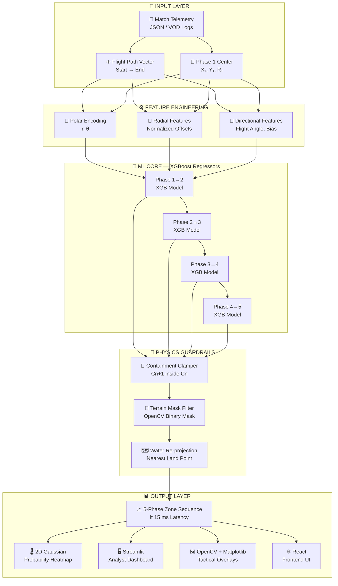
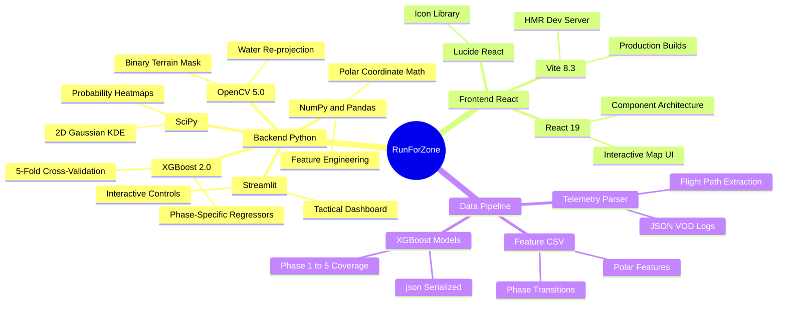
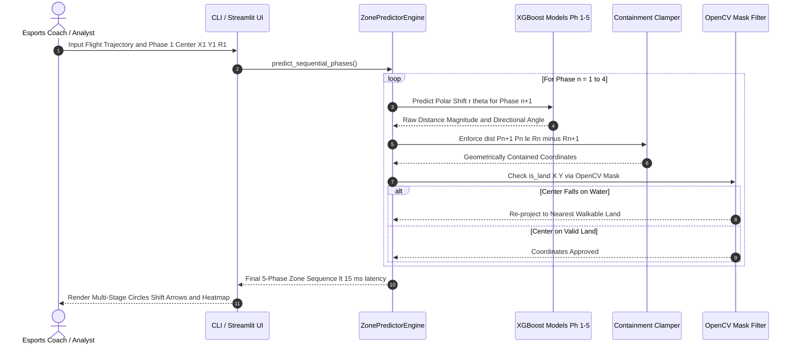
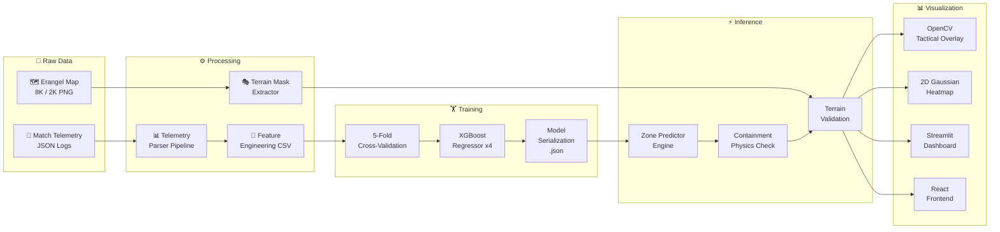
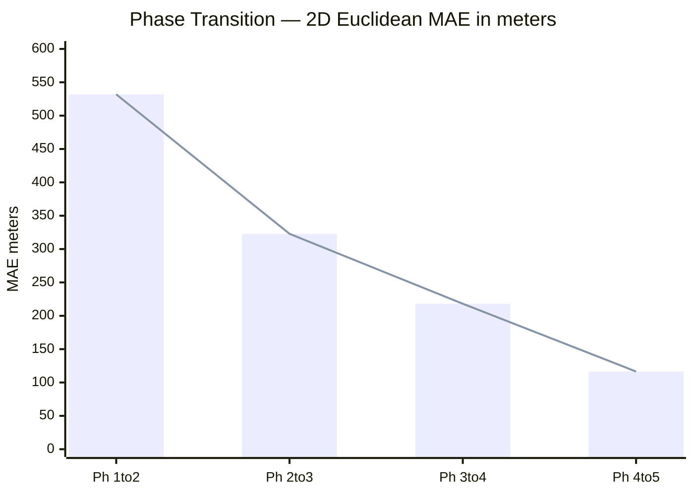
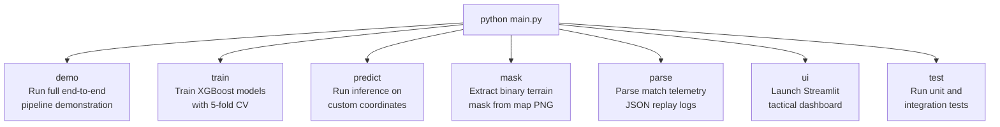

<div align="center">

# 🗺️ RunForZone
### BGMI Offline Multi-Stage Safe Zone Predictor Engine

*High-performance ML + Computer Vision analytics for esports tactical coaching*

[](https://www.python.org/)
[](https://xgboost.readthedocs.io/)
[](https://opencv.org/)
[](https://react.dev/)
[](https://vitejs.dev/)
[](https://streamlit.io/)

[-00C853?style=flat-square)]()
[]()
[]()

</div>

---

> [!IMPORTANT]
> **⚖️ COMPLIANCE & ETHICAL FAIR PLAY MANDATE**
> This engine operates **strictly offline** on recorded tournament VODs, historical match telemetry JSON logs, and tactical "what-if" simulations. It includes **no live game memory hooks, packet sniffers, or runtime screen overlays**, ensuring 100% compliance with game publisher Terms of Service.

---

## 📋 Table of Contents

- [Overview](#-overview)
- [System Architecture](#-system-architecture)
- [Tech Stack](#-tech-stack)
- [Prediction Pipeline](#-multi-stage-prediction-pipeline)
- [Data Flow & Training](#-data-flow--training-lifecycle)
- [Repository Structure](#-repository-structure)
- [Mathematical Formulations](#-mathematical--geometric-formulations)
- [Model Performance](#-model-performance--evaluation)
- [Quick Start](#-quick-start)
- [CLI Reference](#-cli-reference)
- [Frontend UI](#-react-frontend-ui)
- [Visual Outputs](#-visual-output-gallery)
- [Requirements Checklist](#-functional-requirements-checklist)

---

## 🎯 Overview

**RunForZone** is a data-science analytics engine designed for **esports tactical coaches, In-Game Leaders (IGLs), and match analysts** studying sequential BGMI/PUBG safe zone shifts (Phases 1 through 5+) on Erangel.

The engine coordinates:
- 📡 **Telemetry Ingestion** — JSON match logs, flight path vectors, Phase 1 center/radius
- 🧠 **XGBoost ML Core** — Polar-coordinate shift regression per phase transition
- 📐 **Geometric Guardrails** — Strict circle containment physics enforcement
- 🗺️ **Terrain Topology** — OpenCV binary mask filtering with water re-projection
- 📊 **Visual Analytics** — 2D Gaussian heatmaps, tactical overlays, and interactive dashboards

---

## 🏗️ System Architecture



---

## 🛠️ Tech Stack



---

## 🔄 Multi-Stage Prediction Pipeline



---

## 🔧 Data Flow & Training Lifecycle



---

## 📁 Repository Structure

```
RunForZone/
│
├── 📦 src/
│   └── zone_predictor/              # Production Python Package
│       ├── __init__.py              # Top-level package exports
│       ├── config.py                # Erangel constants, phase radii, color palette
│       ├── terrain/
│       │   └── mask_generator.py    # [FR-04] OpenCV binary terrain mask & reprojection
│       ├── telemetry/
│       │   └── parser.py            # [FR-01] JSON telemetry parser & feature engineering
│       ├── models/
│       │   ├── trainer.py           # [FR-02] XGBoost training & 5-fold cross-validation
│       │   └── engine.py            # [FR-03] Containment physics & inference engine
│       └── visualization/
│           └── overlay.py           # [FR-05] OpenCV & Matplotlib overlays & heatmaps
│
├── ⚛️  frontend/                    # React + Vite Frontend UI
│   ├── src/
│   │   └── components/
│   │       └── ImageMapPredictor.jsx  # Interactive zone prediction map component
│   ├── index.html
│   ├── vite.config.js
│   └── package.json
│
├── 📂 data/
│   ├── raw/                         # 8K/2K Erangel maps & match telemetry logs
│   ├── processed/                   # Structured feature CSVs
│   └── masks/                       # Binary terrain masks (erangel_mask.png)
│
├── 🤖 models/                       # Serialized XGBoost models (.json) & metadata
├── 📊 outputs/                      # Rendered maps, heatmaps & evaluation charts
├── 🧪 tests/
│   └── test_containment.py          # Geometric boundary clamp & latency tests
│
├── main.py                          # Unified CLI Entry Point
├── app.py                           # Streamlit Tactical Analyst Dashboard
├── demo_pipeline.py                 # Master end-to-end pipeline runner
├── train_zone_predictor.py          # Standalone training script
├── train_on_tournaments.py          # Tournament-grade batch training
├── evaluate_accuracy.py             # Accuracy evaluation & benchmarking
├── telemetry_parser.py              # Standalone telemetry parser
├── terrain_mask_generator.py        # Standalone mask generator
├── visualizer.py                    # Standalone visualization utilities
├── zone_predictor_engine.py         # Standalone inference engine
├── requirements.txt                 # Python dependencies
└── pyproject.toml                   # Package metadata
```

---

## 📐 Mathematical & Geometric Formulations

### 1. Polar Coordinate Shift Formulation

In circular safe zone shrinking, modeling shifts in Cartesian space (X, Y) ignores radial constraints. The engine predicts in **polar space**:

$$\Delta X = r \cdot \cos(\theta), \quad \Delta Y = r \cdot \sin(\theta)$$

where:
- **r** — Radial shift magnitude, bounded: $0 \le r \le (R_n - R_{n+1})$
- **θ** — Directional angle relative to current phase center: $\theta \in [0°, 360°)$


### 2. Strict Geometric Containment (FR-03)

A valid Battle Royale phase circle $C_{n+1}$ must reside **100% inside** the prior phase circle $C_n$:

$$\sqrt{(X_{n+1} - X_n)^2 + (Y_{n+1} - Y_n)^2} \le (R_n - R_{n+1})$$

If the predicted center violates this bound, the engine scales the translation vector down:

$$\vec{P}_{n+1} = \vec{P}_n + \frac{\vec{\Delta}}{\|\vec{\Delta}\|} \cdot (R_n - R_{n+1}) \cdot 0.98$$

### 3. Terrain Water Filter & Land Re-projection (FR-04)

Using an OpenCV binary mask $M(x, y) \in \{0, 255\}$, if a predicted center lands on water ($M(x,y) = 0$), the Euclidean distance transform projects it to the closest walkable land:

$$\vec{P}^* = \arg\min_{\vec{p} \in \text{Land}} \|\vec{p} - \vec{P}_{n+1}\|$$

---

## ⚡ Model Performance & Evaluation

Evaluated using **5-Fold Cross-Validation** on real tournament match shifts (converted to meters: $1\text{ m} = 100\text{ units}$):

| Phase Transition | Distance MAE (m) | Direction MAE (°) | 2D Euclidean MAE (m) | P90 Error (m) |
| :---: | :---: | :---: | :---: | :---: |
| **Phase 1 → 2** | 197.07 m | 68.10° | 531.97 m | 833.43 m |
| **Phase 2 → 3** | 88.20 m | 88.65° | 322.85 m | 529.86 m |
| **Phase 3 → 4** | 67.54 m | 78.48° | 218.10 m | 379.16 m |
| **Phase 4 → 5** | **37.98 m** | 78.91° | **116.41 m** | **193.98 m** |
| **Overall Average** | **97.70 m** | **78.53°** | **297.33 m** | — |

> [!TIP]
> **Inference Latency:** Single full 5-phase prediction completes in **~10–13 ms** against a **< 500 ms** SLA — roughly **40× faster than requirement**.



---

## 🚀 Quick Start

### Prerequisites

- Python **3.12+**
- Node.js **18+** (for the React frontend)

### 1. Clone & Install Python Backend

```bash
git clone https://github.com/dakshsaini2/RunForZone.git
cd RunForZone
pip install -r requirements.txt
```

### 2. Launch Streamlit Analyst Dashboard

```bash
# Via the unified CLI:
python main.py ui

# Or directly:
python -m streamlit run app.py
```

### 3. Launch React Frontend

```bash
cd frontend
npm install
npm run dev
# → http://localhost:5173
```

---

## 🖥️ CLI Reference

The unified `main.py` CLI exposes the full engine pipeline:



**Command examples:**

```powershell
# Full demo pipeline (Data → Train → Predict → Render)
python main.py demo

# Train XGBoost phase regressors
python main.py train --features data/processed/features.csv --models models/

# Predict zone shifts from custom coordinates
python main.py predict --p1 410000 390000 --flight-start 120000 160000 --flight-end 680000 680000

# Extract terrain mask from Erangel map image
python main.py mask --input data/raw/erangel_map.png --output data/masks/erangel_mask.png

# Parse match telemetry JSON logs
python main.py parse --input data/raw/telemetry --output data/processed/telemetry_features.csv

# Run unit & integration test suite
python main.py test
```

---

## ⚛️ React Frontend UI

The `frontend/` directory contains a **React 19 + Vite** interactive zone prediction interface.

```
frontend/
├── src/
│   └── components/
│       └── ImageMapPredictor.jsx   # Main interactive map component
├── index.html
├── vite.config.js
└── package.json
```

**Run frontend:**
```bash
cd frontend
npm install
npm run dev      # Development server → http://localhost:5173
npm run build    # Production build → dist/
```

**Stack:** React 19 · Vite 8.3 · Lucide React icons

---

## 📊 Visual Output Gallery

All rendered assets are exported to [`outputs/`](./outputs/):

| Asset | Description |
| :--- | :--- |
| `original_map_all_stages.png` | Tactical map with probability heatmap overlay |
| `original_map_all_stages_matplotlib.png` | Publication-quality coordinate overlay |
| `feature_importance.png` | XGBoost feature importance visualization |
| `erangel_mask_preview.png` | Binary terrain mask verification preview |
| `cli_prediction.png` | Output from CLI `predict` command |


## 📄 License & Attribution

Designed for esports analytical research and rotation modeling.

> **BGMI / PUBG** game assets, map topologies, and all related intellectual property are the property of **Krafton, Inc.** This project is an independent offline analytics tool with no affiliation to Krafton.

