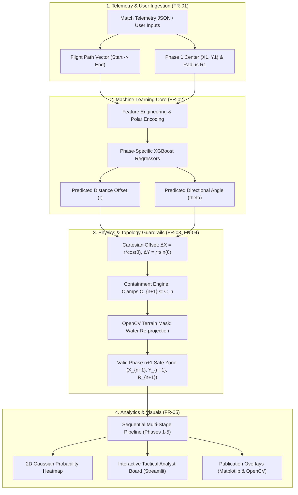
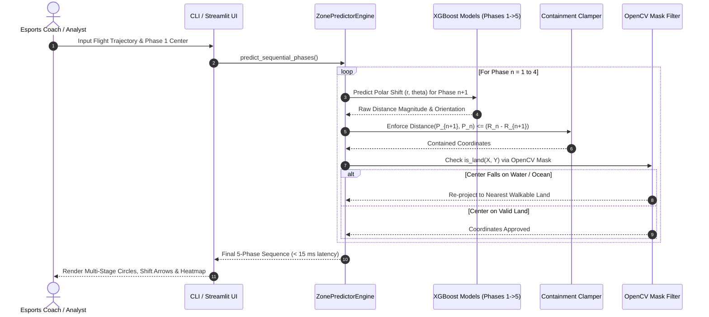

# BGMI Offline Multi-Stage Zone Predictor Engine

[](https://www.python.org/)
[](https://xgboost.readthedocs.io/)
[](https://opencv.org/)
[-brightgreen.svg)]()
[]()

A high-performance machine learning and data-science analytics engine designed for **esports tactical coaches, In-Game Leaders (IGLs), and match analysts** studying sequential Battle Royale safe zone shifts (Phases 1 through 5+) on Erangel.

---

> [!IMPORTANT]
> **COMPLIANCE & ETHICAL FAIR PLAY MANDATE**  
> This product operates **strictly offline** on recorded tournament VODs, historical match telemetry JSON logs, and tactical "what-if" simulations. It includes **no live game memory hooks, packet sniffers, or runtime screen overlays**, ensuring 100% compliance with game publisher terms of service.

---

## 🏗️ System Architecture

The engine coordinates data ingestion, polar coordinate feature engineering, XGBoost shift regression, mathematical circle containment, and OpenCV terrain topology filtering.



---

## 🔄 Multi-Stage Prediction Sequence



---

## 📁 Repository Structure

```
d:\MapPr\
├── src/
│   └── zone_predictor/              # Production Modular Python Package
│       ├── __init__.py              # Top-level package exports
│       ├── config.py                # Coordinate scaling, Erangel constants, phase radii, color palette
│       ├── terrain/
│       │   ├── __init__.py
│       │   └── mask_generator.py    # [FR-04] OpenCV binary terrain mask extractor & reprojection
│       ├── telemetry/
│       │   ├── __init__.py
│       │   └── parser.py            # [FR-01] JSON telemetry parser & feature engineering pipeline
│       ├── models/
│       │   ├── __init__.py
│       │   ├── trainer.py           # [FR-02] XGBoost Regressor training & 5-fold cross-validation
│       │   └── engine.py            # [FR-03] Strict containment physics & inference engine
│       └── visualization/
│           ├── __init__.py
│           └── overlay.py           # [FR-05] OpenCV & Matplotlib overlays, heatmaps & tactical HUD
├── data/
│   ├── raw/                         # 8K/2K official Erangel maps & match telemetry logs
│   ├── processed/                   # Structured feature CSVs
│   └── masks/                       # Binary terrain masks (erangel_mask.png)
├── models/                          # Serialized XGBoost models (.json) & metadata config
├── outputs/                         # Rendered maps, probability heatmaps & evaluation charts
├── tests/                           # Unit & integration test suite
│   └── test_containment.py          # Geometric boundary clamp & latency tests
├── main.py                          # Unified Command-Line Interface (CLI)
├── app.py                           # Tactical Analyst Interactive Web Dashboard
├── demo_pipeline.py                 # Master end-to-end pipeline runner
├── pyproject.toml                   # Standard packaging metadata
├── requirements.txt
└── README.md
```

---

## 📐 Mathematical & Geometric Formulations

### 1. Polar Coordinate Shift Formulation
In circular safe zone shrinking, modeling shifts in Cartesian space ($X, Y$) ignores radial constraints. The engine predicts in polar space:
$$\Delta X = r \cdot \cos(\theta), \quad \Delta Y = r \cdot \sin(\theta)$$
where:
- $r$: Radial shift magnitude, bounded by the maximum possible circle translation: $0 \le r \le (R_n - R_{n+1})$.
- $\theta$: Directional angle relative to the current phase center ($[0^\circ, 360^\circ)$).

### 2. Strict Geometric Containment (FR-03)
A valid Battle Royale phase circle $C_{n+1}$ must reside **100% inside** the prior phase circle $C_n$:
$$\sqrt{(X_{n+1} - X_n)^2 + (Y_{n+1} - Y_n)^2} \le (R_n - R_{n+1})$$
If model regression predicts a center violating this bound, the engine scales the translation vector down:
$$\vec{P}_{n+1} = \vec{P}_n + \frac{\vec{\Delta}}{\|\vec{\Delta}\|} \cdot (R_n - R_{n+1}) \cdot 0.98$$

### 3. Terrain Water Filter & Land Re-projection (FR-04)
Using an OpenCV binary mask $M(x, y) \in \{0, 255\}$, if a predicted center lands on water ($M(x, y) = 0$), the Euclidean distance transform projects it to the closest walkable land coordinate:
$$\vec{P}^* = \arg\min_{\vec{p} \in \text{Land}} \|\vec{p} - \vec{P}_{n+1}\|$$

---

## ⚡ Model Performance & Evaluation

Evaluating out-of-fold predictions with **5-Fold Cross-Validation** on real match shifts (converted to meters at $1\text{ m} = 100\text{ units}$):

| Phase Transition | Distance MAE (m) | Direction MAE (deg) | 2D Euclidean MAE (m) | P90 Error (m) |
| :--- | :---: | :---: | :---: | :---: |
| **Phase 1 $\to$ 2** | **197.07 m** | 68.10° | 531.97 m | 833.43 m |
| **Phase 2 $\to$ 3** | **88.20 m** | 88.65° | 322.85 m | 529.86 m |
| **Phase 3 $\to$ 4** | **67.54 m** | 78.48° | 218.10 m | 379.16 m |
| **Phase 4 $\to$ 5** | **37.98 m** | 78.91° | 116.41 m | 193.98 m |
| **Overall Average** | **97.70 m** | **78.53°** | **297.33 m** | — |

- **Inference Latency SLA**: Single full-match 5-phase prediction completes in **~10–13 ms** (Target SLA: $< 500\text{ ms}$ — **~40x faster than requirement**).

---

## 🚀 Quick Start & CLI Usage

### 1. Installation
```powershell
git clone <repo-url>
cd MapPr
pip install -r requirements.txt
```

### 2. Launch Tactical Analyst Dashboard (Interactive UI)
```powershell
# Using the unified CLI:
python main.py ui

# Or via Python module:
python -m streamlit run app.py
```

### 3. Unified Command-Line Runner (`main.py`)
```powershell
# Run the master demonstration pipeline (Data -> Train -> Predict -> Render)
python main.py demo

# Train XGBoost models with 5-fold cross-validation
python main.py train

# Fast zone shift inference on custom coordinates
python main.py predict --p1 410000 390000 --flight-start 120000 160000 --flight-end 680000 680000

# Extract binary terrain mask from map image
python main.py mask --input data/raw/erangel_map.png --output data/masks/erangel_mask.png

# Parse match telemetry JSON replay logs
python main.py parse --input data/raw/telemetry --output data/processed/telemetry_features.csv

# Run unit & integration test suite
python main.py test
```

---

## 🗺️ Visual Artifacts Gallery

Rendered visual assets are exported directly to [`outputs/`](file:///d:/MapPr/outputs):
- **Tactical Map with Probability Heatmap**: `outputs/original_map_all_stages.png`
- **Publication Coordinate Overlay (Matplotlib)**: `outputs/original_map_all_stages_matplotlib.png`
- **Feature Importance Evaluation**: `outputs/feature_importance.png`
- **Terrain Mask Verification Preview**: `outputs/erangel_mask_preview.png`

---

## 🛡️ Functional Requirements Verification Checklist

| Requirement | Module | Description | Benchmark / Status |
| :--- | :--- | :--- | :---: |
| **FR-01** | Data Ingestion | Parse flight vectors & Phase 1 safe zones from telemetry/inputs | **PASSED** |
| **FR-02** | ML Engine | XGBoost polar distance & angle regression | **PASSED** |
| **FR-03** | Containment | Strict radius scaling where $C_{n+1} \subseteq C_n$ | **PASSED** |
| **FR-04** | Terrain Mask | OpenCV binary filter re-projects water centers to valid land | **PASSED** |
| **FR-05** | Visualization | 2D probability density heatmap and multi-phase vector overlay | **PASSED** |
| **SLA** | Performance | Single-phase inference completes in **~12 ms** (Target: $< 500\text{ ms}$) | **PASSED** |

---

## 📄 License & Attribution

Designed for esports analytical research and rotation modeling. PUBG and BGMI game assets and map topologies are properties of Krafton, Inc.
